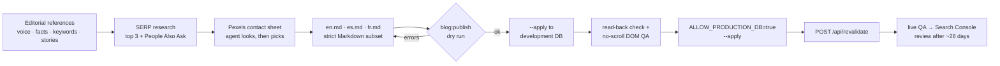

# payload-blog-publish-skill

An AI agent skill plus four small scripts that let Claude Code, Codex or any
agent that reads `SKILL.md` research, write and publish **multilingual blog
articles into Payload CMS 3 on Next.js**, without clicking through the admin
and without letting the agent improvise database writes.

It was extracted from a production B2B site that publishes every article in
three languages. Everything company-specific has been removed; the editorial
files ship as templates you fill in.

**Live example:** [AI Tech Pack Looks Perfect. But at What Cost?](https://www.hlnapparel.com/blog/ai-tech-pack)
was researched, written and published with this workflow in three languages from one set of drafts
([Español](https://www.hlnapparel.com/es/blog/tech-pack-con-ia) · [Français](https://www.hlnapparel.com/fr/blog/tech-pack-ia)).

[中文说明](README.zh-CN.md)



## What is in the box

```text
skill/payload-blog-publish/
  SKILL.md                         the workflow the agent follows (10 steps + failure handling)
  references/                      templates: voice, facts, used keywords, stories
  assets/                          draft template, SERP research brief template
scripts/blog/                      copy into your project
  config.ts                        locales, collection, block slugs, SEO limits, field mapping
  markdown.ts                      Markdown ⇄ Lexical converter (no Payload dependency)
  database.ts                      production database guard
  publish.ts                       blog:publish  (dry run / --apply / read-back / revalidate)
  export.ts                        blog:export   (lossless round-trip export of a live article)
  pexels.mjs                       blog:pexels   (contact sheet + attributed download)
examples/
  payload/Articles.ts              a collection that matches config.ts
  payload/article-blocks.ts        the six Lexical blocks the Markdown maps onto
  payload/revalidate-hooks.ts      admin-side cache purge
  next/revalidate-route.ts         app/api/revalidate/route.ts for CLI writes
test/markdown.test.ts              round-trip and rejection tests
```

## How it works (and why)

### 1. The agent writes files, a script writes the CMS

Letting an agent fill admin forms or call the REST API directly produces
different results every run and leaves nothing to review. Here the agent's
output is plain Markdown in `output/blog-drafts/<slug>/`: diffable, reviewable
by a human, re-runnable. One deterministic script is the only thing that
writes articles. The skill forbids every other write path unless the user asks.

### 2. A strict Markdown subset that maps 1:1 onto Lexical

Payload 3 stores rich text as a Lexical JSON tree. `markdown.ts` accepts only
what the article template can render and maps each construct to exactly one
node or block:

| Markdown | Lexical |
| --- | --- |
| `##`, `###` | `heading` h2 / h3 (the page owns the H1) |
| paragraphs, `-` / `1.` lists, `**bold**`, `*italic*`, `` `code` ``, `[link](url)` | `paragraph`, `list`, text formats, `link` |
| `` on its own line | `articleImage` block (uploads media) |
| `Table: title` + GFM table | `articleTable` block |
| `> quote` | native `quote` |
| `:::callout` / `:::quote` / `:::cta` / `:::video` | the matching custom block |

Anything else (H1, H4+, code fences, HTML, inline images, bare URLs, `•`
bullets, nested lists) is **rejected with a line number**, never approximated.
A draft either publishes exactly as it reads or does not publish. Agents are
good at fixing precise errors and bad at noticing silent degradation.

### 3. Dry run first, JSON out

`pnpm blog:publish <folder>` without `--apply` validates everything and prints
one JSON object: `ok`, `errors`, `warnings`, `action` (`create` or
`update article #42`) and a per-locale `summary` (word count, FAQ count,
H2/H3, tables, images, internal/external links, meta lengths). The agent reads
that against its research brief (is the word count inside 80–120% of the top
three? does the FAQ count equal the People Also Ask count?) before writing
anything.

The dry run also checks:

- **Meta limits** (default 60 / 160 characters, plus forbidden words such as a
  brand suffix the layout appends), using the same validators you attach to
  the Payload fields, so the admin and the CLI agree.
- **Every internal link against the live site.** It must answer 200. A 301/308
  is an error ("link the final URL"), because redirect chains waste crawl
  budget and are a common source of silent 404s after slug changes.
- **Locale-correct links.** A Spanish page may only link `/es/...`; the
  default locale may not link into another locale.
- **Slug collisions** per locale, and duplicate articles.
- **Image rules**: inside `assets/`, alt text in every locale, size limit, and
  new filenames prefixed with the article slug (see 5).

### 4. One document, every locale

The article is found by its default-locale slug. The script creates or updates
the document in that locale, then writes each other locale into **the same
document id**. hreflang alternates stay intact because the page knows every
translation belongs to one document. Updating a single locale is
`--locales=es`.

### 5. Idempotent media

Images are matched by filename across the media library. Re-running a publish
reuses `#id` instead of uploading duplicates, and alt text is written per
locale with `fallbackLocale: false` (so a missing translation never silently
stores the default-language value). To keep "match by filename" safe, a new
file must start with `<slug>-`.

### 6. Read-back verification

After writing, the script reads every locale back with `fallbackLocale: false`
and compares it with what it sent. Rich text is compared **semantically**
(`semanticLexical`): node types, heading tags, list types, text with format,
link URLs and block fields count; generated block ids, empty fields, how text
runs are split, and whitespace formatting do not. `"readBack": "all locales
match"` is the success signal. Anything else means: stop, export, diff.

### 7. Lossless export before editing

Editing a live article starts with `pnpm blog:export <slug>`, which turns
Lexical back into the same Markdown and **proves** it with a round trip:
Markdown → Lexical must equal the stored tree. If an editor used something the
subset cannot express (underline, a nested list, an internal document link),
export reports `"ok": false` and the agent must not republish the body from
that draft. Without this check, "fix a typo" can quietly delete formatting
someone added in the admin.

### 8. A production guard that does not depend on the agent remembering

`database.ts` reads the host of `DATABASE_URL` before Payload connects. If the
host is listed in `PRODUCTION_DB_HOSTS`, the script refuses to run unless the
command itself carries `ALLOW_PRODUCTION_DB=true`, and it prints
`[db] PRODUCTION` / `[db] development` on stderr either way. The skill adds
the human rule: production is written only when the user asked for it in the
current task; otherwise the agent stops after development QA and prints the
command.

### 9. Cache purge from a CLI process

On Vercel-style ISR, a Payload `afterChange` hook calls `revalidatePath`.
That works when you save in the admin, because the hook runs inside Next.js.
A CLI script runs outside Next.js, where `revalidatePath` throws, so the new
article stays invisible until the cache expires. The fix is a tiny
authenticated endpoint (`examples/next/revalidate-route.ts`): after a
production write, `publish.ts` calls `POST /api/revalidate` with a bearer
secret and a named scope. Only whitelisted scopes can be purged; the secret is
compared in constant time.

One gotcha worth knowing: `revalidatePath` takes the **route file path**,
including route groups and dynamic segments
(`/(frontend)/[lang]/blog`), not the public URL. `revalidatePath('/blog')`
silently does nothing for a page under `app/(frontend)/[lang]/blog/`.

### 10. Research rules that keep content honest

The skill tells the agent to:

- read the top three organic results for the same intent and target 80–120%
  of their average main-body length (no padding);
- use only People Also Ask questions that actually appeared; with none, skip
  the FAQ instead of inventing one;
- use competitors for intent, format and coverage only, never their sentences,
  tables or outline;
- add 1–2 things the top three miss, backed by a verified first-hand fact from
  your `facts.md` or `stories.md`;
- answer the query in the first 40–70 words and keep every paragraph quotable
  on its own. AI answer engines (ChatGPT search, Perplexity, Google AI Mode)
  cite single passages;
- check `used-keywords.md` first, and update the page that already owns an
  intent instead of cannibalizing it;
- review Search Console and leads about 28 days later and decide keep, expand,
  retitle, relink or merge. "Published" is not a result.

### 11. Images the agent actually looks at

`blog:pexels search` downloads six candidates and composes a numbered
**contact sheet**. A multimodal agent reads that one image and picks by
number, instead of choosing blind from API alt text. `pick` crops to 1200×675
WebP, saves it as `assets/<slug>-<key>.webp`, and prints both the Markdown
image line and the photographer credit. Stock photos are never presented as
your own premises, staff or products.

### 12. Private knowledge stays private

The skill separates **workflow** (public, this repo) from **editorial
knowledge** (`references/`: your voice, the only numbers you may publish,
which URL owns which keyword, approved customer stories). Fill the templates
in your user-level skill folder; do not commit real internal numbers to a
public repository.

## Setup

Requirements: Next.js App Router, Payload 3 with `localization` enabled and
the Lexical editor, Node 22+ (the examples use `--env-file`), and
`yaml`, `tsx`, `sharp` in the project.

1. Copy `scripts/blog/` into your project and edit `scripts/blog/config.ts`:
   locales, collection slugs, categories, block slugs, SEO limits,
   `localizedPath()`, and the field mapping in `toLocaleData()` /
   `fromLocaleData()` if your Articles collection uses other field names.
2. Make sure your collection has the blocks from
   `examples/payload/article-blocks.ts` (or rename them in the config), and
   that your article page renders them.
3. Add `app/api/revalidate/route.ts` from `examples/next/revalidate-route.ts`,
   and set the route-file paths in `revalidate-targets.ts` to match your
   `app/` folder.
4. Add environment variables (see `.env.example`), with `REVALIDATE_SECRET`
   set to the same value locally and in production.
5. Make sure `tsconfig.json` has the `@payload-config` path (Payload templates
   do) and add the scripts:

   ```json
   {
     "blog:publish": "node --env-file=.env --import tsx scripts/blog/publish.ts",
     "blog:export": "node --env-file=.env --import tsx scripts/blog/export.ts",
     "blog:pexels": "node --env-file=.env scripts/blog/pexels.mjs"
   }
   ```

6. Git-ignore `output/`.
7. Install the skill: copy `skill/payload-blog-publish/` to
   `~/.claude/skills/` (Claude Code, all projects), `.claude/skills/` (one
   project), or your agent's skills folder. Fill in `references/`.

Then ask your agent something like *"write a new blog article about X and
publish it to the development database"*.

## Development

```bash
pnpm install
pnpm test        # round-trip and rejection tests for the converter
pnpm typecheck
```

## License

MIT
